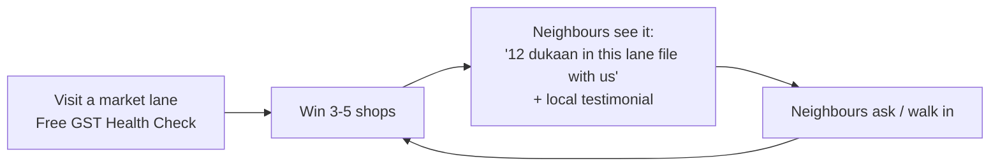
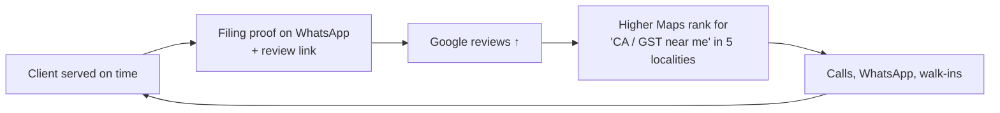
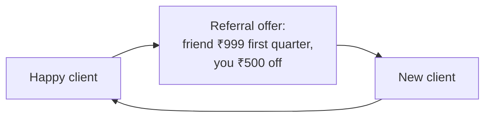
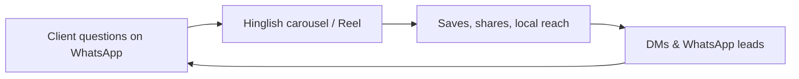

# Growth loops · Singha Tax Consultants · 2026-10-27

**Summary**
- One-off campaigns won't add 1,000 clients on ₹2,000/month. Growth has to **compound**.
- Chosen primary loops: **Market Cluster** (offline, dense social proof shop by shop) + **Review → Maps** (every client makes the next one easier to win).
- Secondary: **Referral** (clients bring clients). Supporting: **Content** (Instagram builds trust and feeds the other loops).

## 1. Market Cluster loop (primary)

- **Input:** owner field hours + flyers (₹). **Output:** clients concentrated by lane, which makes the next sale easier.
- **Cycle time:** ~1–2 weeks per lane. **Gain [Estimate]:** each 5 clients in a lane → 1–3 neighbour enquiries.
- **Leaks:** follow-up speed; no visible proof. Fix: same-day WhatsApp follow-up; consented testimonials named by lane.

## 2. Review → Maps loop (primary)

- **Input:** each completed filing. **Gain:** reviews compound rank. Target 25 reviews by 30 Nov, 100 by 31 Mar.
- **Leaks:** forgetting to ask. Fix: the review request is part of the filing-proof message template, every time.

## 3. Referral loop (secondary)

- **Gain [Estimate]:** 10–20% of clients refer at least one in 3 months, if asked at the right moment (after filing proof).
- ⚠ CA Prateek to confirm the offer wording (see offers file).

## 4. Content loop (supporting)

- Instagram's job is **trust and reminders**, not volume by itself. Every post ends with the WhatsApp CTA.

## Scoring
| Loop | Gain | Speed | Cost | Feasibility with 2 people | Pick |
|---|---|---|---|---|---|
| Market Cluster | High | Fast | Flyers only | Medium (needs field hours) | **Primary** |
| Review → Maps | High (compounding) | Medium | Free | High | **Primary** |
| Referral | Medium | Medium | Discounts | High | Secondary |
| Content | Low–Medium | Slow | Free (time) | High (Carousel Studio) | Supporting |
| Paid | Low at ₹2k/month | Fast | ₹ | High | Experiment only |

## Metrics per loop (weekly)
- **Cluster:** lanes active · shops visited · health checks done · clients won per lane
- **Maps:** reviews total · GBP calls / direction requests / website clicks
- **Referral:** referral asks sent · referred leads · referred clients
- **Content:** posts published · reach · saves · DMs/WhatsApp from Instagram
